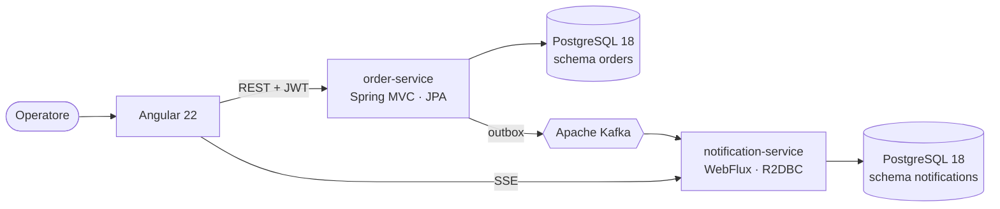

# Gestione Ordini

[](https://github.com/mlimber64/gestione-ordini/actions/workflows/ci.yml)

Sistema di gestione degli ordini con architettura a microservizi: catalogo, magazzino e ordini con riserva atomica delle giacenze, eventi su Apache Kafka e notifiche in tempo reale.

Progetto di portafoglio, sviluppato in modo incrementale con milestone, pull request e decisioni documentate. **Stato: in sviluppo (M0, fondamenta).**

## Stack

| Livello | Tecnologia |
|---|---|
| Backend principale | Java 25, Spring Boot 4.1, Spring MVC con thread virtuali, JPA, Flyway |
| Backend reattivo | Spring WebFlux, R2DBC, Project Reactor |
| Frontend | Angular 22, TypeScript 6, Angular Material |
| Database | PostgreSQL 18 |
| Messaggistica | Apache Kafka 4 (KRaft) con pattern transactional outbox |
| Sicurezza | Spring Security, JWT |
| Qualità | JUnit, Testcontainers, JaCoCo, SonarCloud |
| Infrastruttura | Docker, Docker Compose, GitHub Actions |

## Architettura



- **order-service**: architettura esagonale, organizzata per funzionalità (identity, customer, catalog, inventory, order). Pubblica gli eventi tramite outbox.
- **notification-service**: servizio reattivo che consuma gli eventi in modo idempotente ed espone uno stream SSE.
- **web**: applicazione Angular con rotte caricate a richiesta.

Le decisioni principali sono documentate in [docs/adr](docs/adr).

## Avvio rapido

Prerequisiti: JDK 25, Node 24 LTS e Docker.

```bash
# Infrastruttura: PostgreSQL 18 e Kafka (porte 15432 e 19092)
docker compose -f deploy/docker-compose.yml up -d

# Servizi
cd services/order-service && ./mvnw spring-boot:run          # http://localhost:8081
cd services/notification-service && ./mvnw spring-boot:run   # http://localhost:8082

# Frontend
cd web && npm ci && npm start                                # http://localhost:4200
```

| Componente | Porta |
|---|---|
| PostgreSQL | 15432 |
| Kafka | 19092 |
| order-service | 8081 |
| notification-service | 8082 |
| web (sviluppo) | 4200 |

I test di integrazione usano Testcontainers: richiedono solo Docker in esecuzione.

## Struttura

```
services/
  order-service/          Spring MVC, JPA, Flyway, outbox
  notification-service/   WebFlux, R2DBC, consumer Kafka, SSE
web/                      Angular 22
deploy/                   Docker Compose e configurazione dell'infrastruttura
docs/adr/                 Architecture Decision Record
.github/                  CI, template di issue e pull request, Dependabot
```

## Roadmap

- [x] **M0** Fondamenta: struttura, Compose, CI, ADR
- [ ] **M1** Identità e catalogo: login JWT, clienti, prodotti
- [ ] **M2** Magazzino e ordini: riserva atomica, macchina a stati
- [ ] **M3** Eventi: outbox e topic Kafka
- [ ] **M4** Notifiche: servizio WebFlux e stream SSE
- [ ] **M5** Applicazione Angular
- [ ] **M6** Qualità e rilascio v1.0

## Autore

**Limber Mendoza**, sviluppatore Full Stack a Salerno.
[LinkedIn](https://www.linkedin.com/in/limber-mendoza-tolentino-852771142/) · [mlimber64@gmail.com](mailto:mlimber64@gmail.com)
