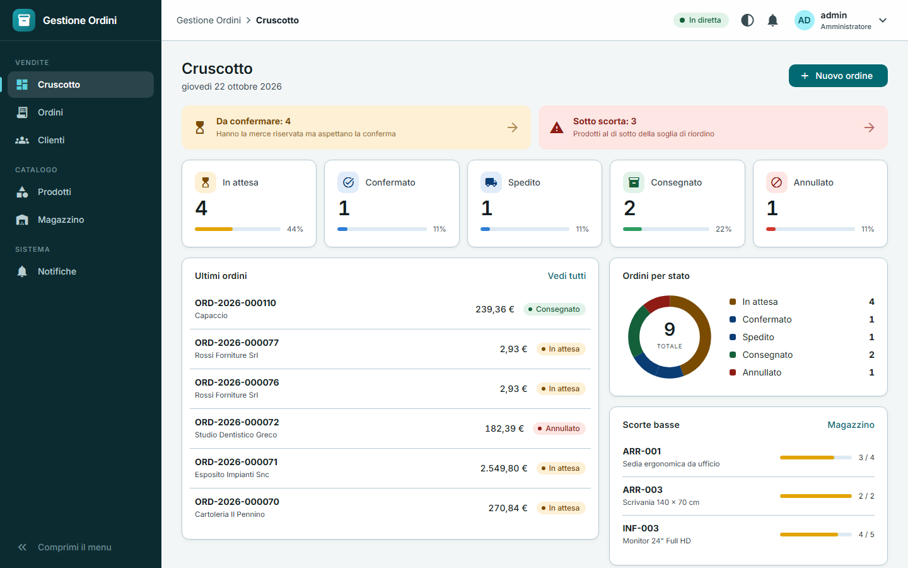
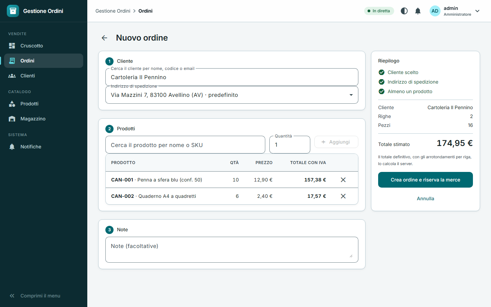
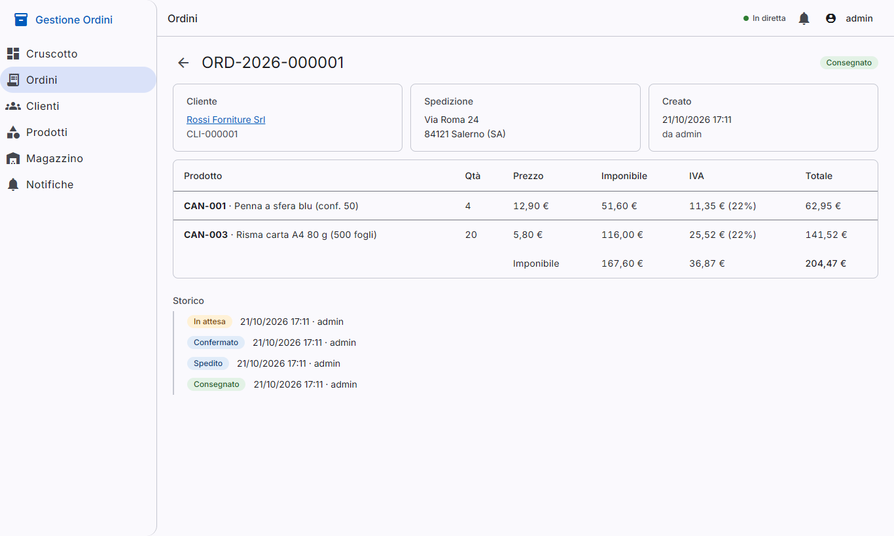
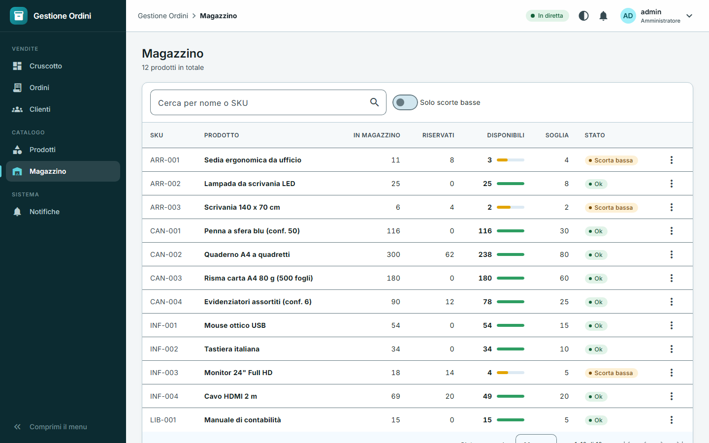
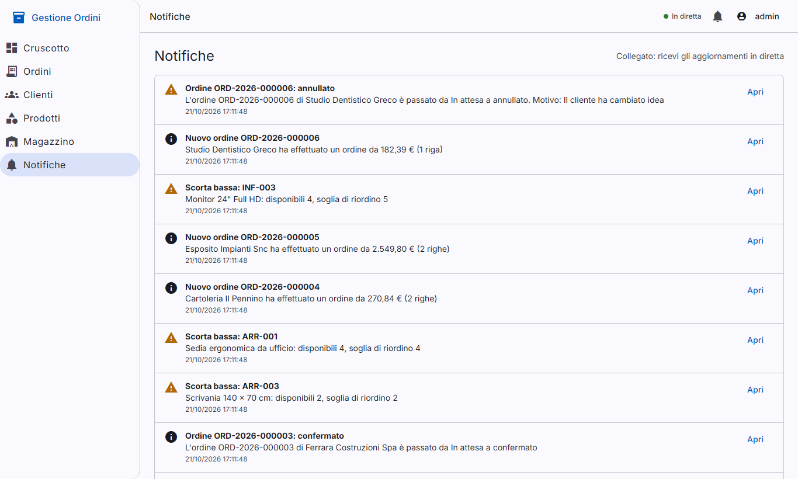
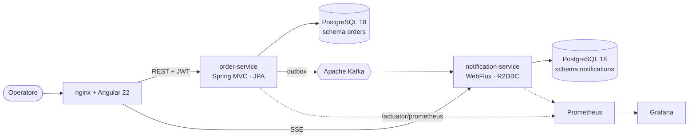
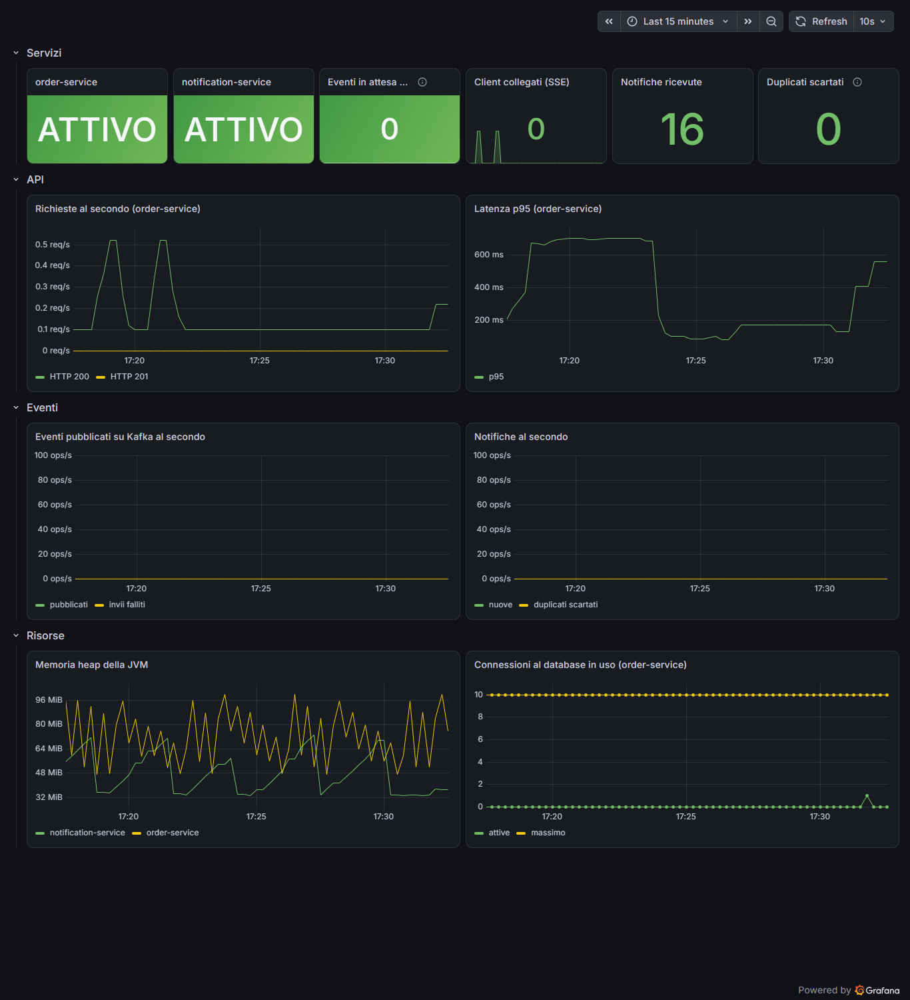

# Gestione Ordini

[](https://github.com/mlimber64/gestione-ordini/actions/workflows/ci.yml)


Sistema di gestione degli ordini con architettura a microservizi: catalogo, magazzino e ordini con **riserva atomica delle giacenze**, eventi su Apache Kafka con **transactional outbox** e notifiche in tempo reale.

Progetto di portafoglio, sviluppato in modo incrementale con milestone, pull request e decisioni documentate ([ADR](docs/adr)).



## Provalo in due comandi

Serve solo Docker.

```bash
docker compose -f deploy/docker-compose.yml --profile app up -d --build
node deploy/seed.mjs        # dati di esempio (facoltativo, richiede Node 18 o successivo)
```

Apri **http://localhost:8080** ed entra con `admin` / `admin-demo-1234` (valori di demo: vedi [Configurazione](#configurazione)). Lo stesso sito è su **https://localhost:8443** con HTTP/2 e un certificato autofirmato (il browser avvisa: è normale in locale), utile per tenere aperte molte schede con le notifiche in diretta ([ADR 0015](docs/adr/0015-https-e-http2-davanti-al-frontend.md)).

Senza compilare nulla: dalle versioni successive alla 1.0.0 le immagini si pubblicano su GitHub (`ghcr.io/mlimber64/gestione-ordini/…`) e si possono scaricare già pronte, scegliendo la versione con `GESTIONE_ORDINI_VERSION` (vedi [ADR 0017](docs/adr/0017-immagini-pubblicate-su-ghcr.md)):

```bash
docker compose -f deploy/docker-compose.yml -f deploy/docker-compose.ghcr.yml --profile app up -d
```

Per aggiungere metriche e dashboard: `--profile observability`, poi Grafana su **http://localhost:3000**. Per spegnere tutto: `docker compose -f deploy/docker-compose.yml --profile app --profile observability down`.

## Cosa fa

| | |
|---|---|
|  | **Ordini.** Si cercano cliente e prodotti, si vede il totale stimato e alla conferma il server riserva la merce di tutte le righe in un'unica transazione: se una riga non ha giacenza, non si riserva nulla. |
|  | **Ciclo di vita e storico.** `In attesa → Confermato → Spedito → Consegnato`, con annullamento prima della spedizione. Ogni passo resta nello storico, con chi l'ha fatto e perché. Cliente, indirizzo e prezzi sono copiati nell'ordine: lo storico non cambia se cambia il listino. |
|  | **Magazzino.** Giacenza fisica, riservata e disponibile; carico, rettifica con motivo, soglia di riordino e registro dei movimenti. Sotto soglia parte un avviso in tempo reale. |
|  | **Notifiche in diretta.** Ogni evento arriva alle schermate aperte via SSE, in italiano. Se la connessione cade, al ritorno si recuperano le notifiche perse senza buchi né doppioni. |

**Pagamenti.** Nel dettaglio di ogni ordine un operatore registra bonifici, carte o contrassegni, anche a più riprese (acconto e saldo), poi li incassa, li segna come non riusciti o li rimborsa. L'ordine risulta `Da pagare`, `Pagato in parte` o `Pagato` e non si può mai incassare più del suo totale ([ADR 0018](docs/adr/0018-pagamenti-registrati-a-mano.md)). Il pagamento è un dato a parte: non cambia lo stato dell'ordine.

## Stack

| Livello | Tecnologia |
|---|---|
| Backend principale | Java 25, Spring Boot 4.1, Spring MVC con thread virtuali, JPA, Flyway |
| Backend reattivo | Spring WebFlux, R2DBC, Project Reactor |
| Frontend | Angular 22, TypeScript 6, Angular Material (tema sobrio), signals |
| Database | PostgreSQL 18 |
| Messaggistica | Apache Kafka 4 (KRaft) con pattern transactional outbox |
| Sicurezza | Spring Security, JWT (accesso e refresh), ruoli ADMIN, OPERATOR, VIEWER |
| Qualità | JUnit, Testcontainers, ArchUnit, JaCoCo, Vitest, SonarCloud |
| Osservabilità | Micrometer, Prometheus, Grafana |
| Infrastruttura | Docker, Docker Compose, nginx, GitHub Actions |

## Architettura



- **order-service**: architettura esagonale organizzata per funzionalità (identity, customer, catalog, inventory, order, payment); le regole di ordini, magazzino e pagamenti stanno in un dominio senza dipendenze da JPA né da Spring, verificato con ArchUnit. Pubblica gli eventi tramite outbox.
- **notification-service**: servizio reattivo che consuma gli eventi in modo idempotente (un evento ricevuto due volte genera una sola notifica), manda in dead-letter i messaggi illeggibili ed espone lo stream SSE.
- **web**: applicazione Angular con rotte caricate a richiesta; il token di accesso vive solo in memoria.

### Garanzie che il progetto dimostra con i test

- **Nessuna vendita doppia**: 20 richieste simultanee per 5 pezzi producono esattamente 5 ordini e 15 risposte `409`.
- **Nessun blocco reciproco**: ordini simultanei con gli stessi prodotti in ordine inverso si completano tutti.
- **Un annullamento solo**: sei annullamenti simultanei dello stesso ordine liberano la merce una volta sola.
- **Mai incassare oltre il totale**: dieci pagamenti simultanei da 10 € su un ordine da 61 € ne accettano esattamente sei.
- **Nessun evento perso**: con Kafka spento l'ordine viene accettato e l'evento parte appena Kafka torna.
- **Nessun evento fantasma**: una transazione annullata non lascia alcun evento.

## Decisioni di progetto

| ADR | Decisione |
|---|---|
| [0001–0008](docs/adr) | Java 25, Spring Boot 4.1, MVC per gli ordini e WebFlux per le notifiche, PostgreSQL e Flyway, Kafka con outbox, architettura esagonale, Angular 22, Kanban |
| [0009](docs/adr/0009-jwt-stateless.md) | Autenticazione JWT stateless con token di accesso e di refresh |
| [0010](docs/adr/0010-riserva-atomica-delle-giacenze.md) | Riserva atomica delle giacenze e macchina a stati dell'ordine |
| [0011](docs/adr/0011-outbox-e-contratto-degli-eventi.md) | Transactional outbox e contratto degli eventi |
| [0012](docs/adr/0012-notifiche-sse-e-consumer-idempotente.md) | Notifiche con SSE e consumer idempotente |
| [0013](docs/adr/0013-frontend-angular-material.md) | Frontend Angular con Material, sessione in memoria e SSE con fetch |
| [0014](docs/adr/0014-consegna-e-osservabilita.md) | Consegna con Docker, metriche e controlli di qualità |
| [0015](docs/adr/0015-https-e-http2-davanti-al-frontend.md) | HTTPS e HTTP/2 davanti al frontend |
| [0016](docs/adr/0016-conservazione-delle-notifiche.md) | Conservazione delle notifiche |
| [0017](docs/adr/0017-immagini-pubblicate-su-ghcr.md) | Immagini Docker pubblicate su GHCR |
| [0018](docs/adr/0018-pagamenti-registrati-a-mano.md) | Pagamenti registrati a mano |

La qualità e le metriche sono descritte in [docs/qualita.md](docs/qualita.md).



## Sviluppo in locale

Prerequisiti: JDK 25, Node 24 LTS e Docker.

```bash
# Infrastruttura: PostgreSQL 18 e Kafka (porte 15432 e 19092)
docker compose -f deploy/docker-compose.yml up -d

# Servizi (profilo dev: segreti di sviluppo già impostati)
cd services/order-service && ./mvnw spring-boot:run          # http://localhost:8081
cd services/notification-service && ./mvnw spring-boot:run   # http://localhost:8082

# Frontend, con proxy verso i servizi: nessun CORS da configurare
cd web && npm ci && npm start                                # http://localhost:4200
```

In questa modalità l'utente è `admin` / `admin-dev-1234`.

| Componente | Porta |
|---|---|
| web (sviluppo) | 4200 |
| web (Docker) | 8080 (HTTP), 8443 (HTTPS con HTTP/2) |
| order-service | 8081 |
| notification-service | 8082 |
| PostgreSQL | 15432 |
| Kafka | 19092 |
| Prometheus, Grafana (Docker) | 9090, 3000 |

I test usano Testcontainers: richiedono solo Docker in esecuzione. `./mvnw verify` esegue anche il controllo di copertura minima.

### Test nel browser

I test di punta a punta (Playwright, cartella `e2e/`) provano l'applicazione completa: accesso, nuovo ordine, conferma, notifiche in diretta, pagamenti e otto schede aperte insieme su HTTP/2. Non avviano nulla da soli, quindi serve prima lo stack Docker:

```bash
docker compose -f deploy/docker-compose.yml --profile app up -d --build
cd e2e && npm ci && npx playwright install chromium
npm test                  # npm run test:headed per vedere il browser
```

Gli indirizzi e le credenziali si cambiano con `E2E_BASE_URL`, `E2E_USER` ed `E2E_PASSWORD`. In CI girano nel job `e2e`.

### API

- Documentazione interattiva: `http://localhost:8081/swagger-ui.html`
- Contratto OpenAPI: `http://localhost:8081/v3/api-docs`

```text
POST /api/v1/auth/login | refresh
POST /api/v1/inventory/{productId}/receipts       carico merce
POST /api/v1/inventory/{productId}/adjustments    rettifica (anche negativa, con motivo)
GET  /api/v1/inventory?lowStock=true              prodotti sotto scorta
POST /api/v1/orders                               crea l'ordine e riserva la merce (409 se non basta)
POST /api/v1/orders/{id}/confirm | ship | deliver | cancel
GET  /api/v1/orders/{id}/payments                 pagamenti dell'ordine con incassato e residuo
POST /api/v1/orders/{id}/payments                 registra un pagamento (422 se supera il totale)
POST /api/v1/payments/{id}/pay | fail | refund    incassa, segna come non riuscito, rimborsa
GET  /api/v1/orders?status=&customerId=&from=&to= ricerca paginata
GET  /api/v1/notifications/stream                 SSE (notification-service), con Last-Event-ID
```

Eventi pubblicati su Kafka: `orders.order-created.v1`, `orders.order-status-changed.v1`, `inventory.stock-low.v1`. I messaggi non elaborabili finiscono in `<topic>.DLT`. Per vederli: `docker exec gestione-ordini-kafka /opt/kafka/bin/kafka-console-consumer.sh --bootstrap-server localhost:9092 --topic orders.order-created.v1 --from-beginning`

## Configurazione

I valori predefiniti servono **solo a provare l'applicazione sul proprio computer**. Per qualunque altro uso:

| Variabile | Significato | Obbligatoria fuori da `dev` |
|---|---|---|
| `SPRING_PROFILES_ACTIVE` | Profilo attivo (`dev` è il predefinito in locale) | sì |
| `JWT_SECRET` | Segreto di firma dei JWT, almeno 32 byte; lo stesso per i due servizi | sì |
| `ADMIN_USERNAME`, `ADMIN_PASSWORD` | Amministratore creato al primo avvio | `ADMIN_PASSWORD` sì |
| `DB_URL`, `DB_USER`, `DB_PASSWORD`, `R2DBC_URL` | Connessione a PostgreSQL | no |
| `KAFKA_BOOTSTRAP_SERVERS` | Indirizzo di Kafka | no |

Le notifiche vecchie si eliminano ogni notte: restano 30 giorni di base (`APP_NOTIFICATIONS_RETENTION`, per esempio `45d`; deve restare più lungo della conservazione di Kafka, vedi [ADR 0016](docs/adr/0016-conservazione-delle-notifiche.md)).

Con Docker si impostano in `deploy/.env` (vedi `deploy/.env.example`). Le metriche (`/actuator/prometheus`) non contengono dati sensibili ma non vanno esposte: il reverse proxy inoltra solo `/api` e le porte dei servizi non sono pubblicate.

## Struttura

```
services/
  order-service/          Spring MVC, JPA, Flyway, outbox
  notification-service/   WebFlux, R2DBC, consumer Kafka, SSE
web/                      Angular 22 e configurazione nginx
e2e/                      Test nel browser con Playwright
deploy/                   Docker Compose, Prometheus, Grafana, dati di esempio
docs/                     ADR, qualità, immagini
.github/                  CI, template di issue e pull request, Dependabot
```

## Roadmap

- [x] **M0** Fondamenta: struttura, Compose, CI, ADR
- [x] **M1** Identità e catalogo: login JWT con ruoli, clienti e indirizzi, categorie, prodotti
- [x] **M2** Magazzino e ordini: riserva atomica, macchina a stati
- [x] **M3** Eventi: outbox e topic Kafka
- [x] **M4** Notifiche: servizio WebFlux e stream SSE
- [x] **M5** Applicazione Angular
- [x] **M6** Qualità e rilascio v1.0: Docker, metriche e Grafana, copertura, SonarCloud pronto

Possibili sviluppi: pagamenti, un identity provider esterno (Keycloak) e CDC al posto del polling dell'outbox.

## Autore

**Limber Mendoza**, sviluppatore Full Stack a Salerno.
[LinkedIn](https://www.linkedin.com/in/limber-mendoza-tolentino-852771142/) · [mlimber64@gmail.com](mailto:mlimber64@gmail.com)

Licenza [MIT](LICENSE).
